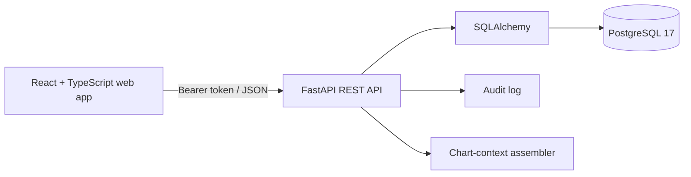

# Architecture and API

## Components

The API is the sole application boundary for database access. The browser keeps its short-lived bearer token in `sessionStorage`; it is cleared when the browser session ends. The API uses role checks at route boundaries. The chart-context assembler reads recorded data and returns its source records without generating a diagnosis.

## Data areas

| Area | Main records | Workflow |
|---|---|---|
| Patient services | Patient, Provider, Appointment | Register → schedule → check in → complete |
| Clinical | Encounter | Record clinician-authored notes, assessment, plan, and vitals |
| Diagnostics | LabOrder | Order → process → record result |
| Pharmacy | Medication, Prescription | Clinician order → pharmacy dispense → stock update |
| Billing | Invoice, InvoiceLine | Itemize → mark paid |
| Administration | User, AuditLog | Authenticate → authorize → record mutations |

## API routes

All routes except `/health` and `/api/v1/auth/login` require a bearer token.

| Method | Route | Purpose |
|---|---|---|
| POST | `/api/v1/auth/login` | Obtain a short-lived access token |
| GET | `/api/v1/auth/me` | Current account and role |
| GET/POST | `/api/v1/patients` | Search and register patient records |
| GET | `/api/v1/patients/{id}` | Read one patient record |
| GET | `/api/v1/providers` | Read active provider directory |
| GET/POST/PATCH | `/api/v1/appointments` | Schedule and update visits |
| GET/POST | `/api/v1/encounters` | Read and record clinician encounters |
| GET/POST/PATCH | `/api/v1/labs` | Order tests and record results |
| GET/POST/PATCH | `/api/v1/medications` | Inventory and stock adjustments |
| GET/POST/PATCH | `/api/v1/prescriptions` | Prescriptions and dispensing |
| GET/POST/PATCH | `/api/v1/invoices` | Create invoices and record payment status |
| GET | `/api/v1/analytics/summary` | Operational counts and department activity |
| GET | `/api/v1/patients/{id}/care-summary` | Draft chart context for clinician review |
| GET | `/api/v1/audit` | Admin-only audit events |

Interactive OpenAPI documentation is available at `/docs` while the API is running.

## Role model

The seeded demo account is `admin`. Routes also recognize `reception`, `clinician`, `lab`, `pharmacy`, and `billing` roles. The MVP does not yet include a user-management screen or account provisioning API; additional accounts must be provisioned by a trusted operator.
